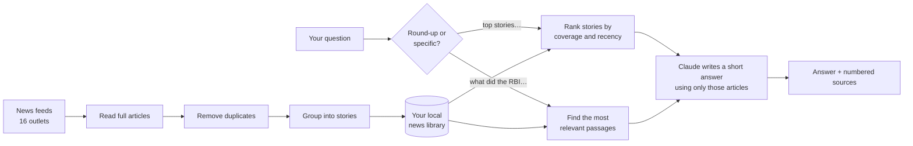

# Dynamic News RAG

**Ask questions about today's news and get short, sourced answers drawn from 16 Indian and international news outlets.**

```text
$ newsrag ask "What are the top stories in India today?"
(top stories, India, last 24h)

**Kashmir's last known active terrorist killed** — Security forces killed LeT's Lateef Bhat
in an encounter in Kulgam; four outlets covered it [1][2][3].

**Cyclone Akvan heads for the Andhra–Odisha coast** — The cyclone is expected to cross between
Machilipatnam and Puri, with red alerts in six districts [4][5].
...

Sources:
  [1] LeT's Lateef Bhat killed in Kulgam encounter
      Times of India · 3h ago · https://timesofindia.indiatimes.com/...
  ...
```

*(The answer above is shortened and shows the format. The stories are real ones from a test run in November 2026.)*

---

## Contents

1. [Why this exists](#why-this-exists)
2. [How it helps](#how-it-helps)
3. [What it does today](#what-it-does-today)
4. [How it works, in plain terms](#how-it-works-in-plain-terms)
5. [Getting started](#getting-started)
6. [Using it](#using-it)
7. [Keeping the news fresh](#keeping-the-news-fresh)
8. [Choosing your news sources](#choosing-your-news-sources)
9. [Settings](#settings)
10. [What it costs](#what-it-costs)
11. [Limitations](#limitations)
12. [Troubleshooting](#troubleshooting)
13. [What's next](#whats-next)
14. [For developers](#for-developers)
15. [Responsible use](#responsible-use)

---

## Why this exists

Keeping up with the news is harder than it should be.

- **There's too much of it.** A single outlet publishes hundreds of articles a day, and the same event is covered by a dozen outlets in slightly different words.
- **Headlines aren't answers.** If you want to know "what did the RBI actually decide?", you usually have to open several articles and piece it together yourself.
- **AI chatbots don't know what happened this morning.** Language models are trained on data that stops at a certain date. Ask one about today's news and it will either say it doesn't know or, worse, confidently make something up.
- **One outlet is one point of view.** Reading only one paper means missing what others reported, or how they framed it differently.

This project started as a small experiment: a notebook that pulled Times of India headlines and let you ask questions about them. It has grown into a tool that reads many outlets continuously, understands which articles are about the same event, and answers questions in plain language, **always showing which articles each statement came from**, so you can check it yourself.

The technique behind it is called **RAG (retrieval-augmented generation)**. Instead of asking an AI model to answer from memory, the app first *finds* the relevant articles, then hands those articles to the model and asks it to answer **using only them**. That keeps answers current and makes them checkable.

## How it helps

| If you want to… | Ask something like… | What you get |
| --- | --- | --- |
| Catch up quickly | "What are the top stories in India today?" | The most widely covered stories, most important first, each in one or two sentences with sources |
| Understand one story | "What did the RBI decide this week?" | A short answer pulled from the relevant articles, with the date each development happened |
| Follow a specific area | "Tech headlines", "Any cricket news today?" | A round-up limited to that section |
| Check a claim | "Did Nvidia say it would reinstate Jensen Huang?" | What the outlets actually reported, and where they disagree |
| Have a conversation | "What did the opposition say about it?" (after a previous question) | Follow-up answers that remember what "it" refers to |
| Get a morning summary | `newsrag briefing` | A digest of the stories most outlets are covering |

It's useful for:

- **Busy readers** who want the important stories without scrolling through feeds.
- **Students preparing for exams** like UPSC that test current affairs, who need accurate, dated facts with sources.
- **Anyone curious about how news is covered**, because answers show which outlets reported each point.
- **Developers and students learning AI**, as a complete, working example of a real-world RAG system with tests and an evaluation.

## What it does today

### Reads 46 news feeds from 16 outlets
Times of India, The Hindu, The Indian Express, Hindustan Times, NDTV, The Economic Times, Mint, BBC News, The Guardian, Al Jazeera, NPR, Deutsche Welle, Ars Technica, TechCrunch, The Verge and ESPNcricinfo. They cover India, world, business, tech, science and sports. You can add or remove sources by editing one file (see [Choosing your news sources](#choosing-your-news-sources)).

### Reads the full article, not just the headline
For each new link it downloads the article page and pulls out the main text, leaving out menus, ads and "read more" links. In a test run, **98% of about 850 articles** were captured in full. When a page can't be read (for example a paywall), it falls back to the short summary from the feed and marks that article as summary-only.

### Spots duplicates and groups articles into stories
- The **same link** shared in several sections is stored once.
- The **same wire story** (from agencies like PTI or Reuters) republished by several outlets is stored once.
- **Different articles about the same event** are grouped into one *story*. For example, in one test run 17 articles from 10 outlets about Nvidia's CEO were recognised as a single story.

That grouping is what lets the app tell how important a story is: something covered by ten outlets matters more than something only one outlet ran.

### Tells "round-up" questions from specific ones
- **Round-up questions** ("top stories in India today", "world headlines", "catch me up") are answered by ranking stories by **how many outlets covered them and how recently**. You get the genuinely big stories, not articles that happen to contain the words "top" and "today".
- **Specific questions** ("what did the RBI decide?") search for the most relevant passages using both exact keywords and meaning, so "interest rates" also finds articles that only say "repo rate".

### Understands time
"Today", "yesterday", "this week" and "past 3 days" are turned into date filters. Words like "latest" make the app prefer newer articles.

### Keeps answers balanced and on-topic
- No more than **2 passages from any one outlet** per answer, so one outlet can't dominate.
- **Routine service pieces** (daily fuel prices, "stocks to buy", horoscopes, how-to-register guides) are left out of round-ups unless you ask about them.
- **Weak matches are dropped**, so a question with only three good matching articles gets an answer from those three instead of being padded with unrelated news.

### Answers with citations
Every factual sentence carries a number like **[2]** that points to a listed article with its outlet, how long ago it was published, and a link. The AI is instructed to use **only** those articles, to say when outlets disagree, and to say plainly when it can't find the answer.

### Chat, briefings and more
- **Chat mode** for back-and-forth conversations with follow-up questions.
- **Daily briefing** of the most-covered stories.
- **Search mode** that shows the matching passages without using AI (free, and useful for checking what the app found).
- **Quality check** (`newsrag eval`) that measures how often search finds the right article.

### Looks after itself
- Checks only for **new** articles on each run, and skips feeds that haven't changed.
- Treats news sites politely: it identifies itself, follows each site's robots.txt rules, and makes **at most one request per second to any one site**, while still reading many sites in parallel.
- **Saves as it goes**, so stopping a run part-way doesn't lose what it already collected.
- **Deletes articles older than 30 days** so the database stays small.

### Speed
In testing, the first full run collected about 850 articles in **under 7 minutes**. Later runs only fetch articles published since the last run, so they're much quicker. A typical question is answered in a few seconds.

## How it works, in plain terms



1. **Collect.** `newsrag ingest` checks every feed, downloads new articles and stores them on your computer.
2. **Organise.** Each article is split into short passages, and each passage gets a "meaning fingerprint" (an *embedding*) so it can be found by meaning, not just exact words. Articles about the same event are grouped into stories.
3. **Find.** When you ask something, the app either ranks the top stories (for round-ups) or finds the most relevant passages (for specific questions).
4. **Answer.** Those passages are sent to Claude, Anthropic's AI model, with strict instructions to answer only from them and to cite each statement.

Everything except step 4 runs on your own computer. Only the passages needed for your question are sent to the AI.

## Getting started

You'll need:
- A Mac, Linux or Windows computer with **Python 3.11 or newer**
- An internet connection
- An **Anthropic API key** for written answers (see step 4). Everything except written answers works without one.

The steps below are for a Mac. Linux is the same apart from installing Python, and Windows notes are at the end of this section.

### 1. Install Python and git (one time)

Open **Terminal** (press Cmd+Space and type "Terminal"). If you don't have [Homebrew](https://brew.sh), install it first using the command on its website. Then:

```bash
brew install python@3.13 git
```

### 2. Download the project

```bash
cd ~/Documents
```
```bash
git clone https://github.com/SriAkhilMylavarapu/Dynamic_News_RAG.git
```
```bash
cd Dynamic_News_RAG
```

### 3. Set up a private Python environment and install

This keeps the project's packages separate from the rest of your computer.

```bash
python3.13 -m venv .venv
```
```bash
source .venv/bin/activate
```
```bash
pip install --upgrade pip
```
```bash
pip install -e .
```

Your Terminal prompt should now start with `(.venv)`. **Every time you open a new Terminal window**, go to the project folder and run `source .venv/bin/activate` again before using the app.

### 4. Add your API key

1. Sign in at [console.anthropic.com](https://console.anthropic.com), add some billing credit, then go to **Settings → API Keys → Create Key**. Copy the key; it's only shown once.
2. Create your settings file from the template and open it:
   ```bash
   cp .env.example .env
   ```
   ```bash
   nano .env
   ```
3. Paste your key after `ANTHROPIC_API_KEY=`, with no spaces or quotes:
   ```
   ANTHROPIC_API_KEY=sk-ant-api03-...
   ```
4. Save with **Ctrl+O**, press **Enter**, and exit with **Ctrl+X**.

Use `nano` rather than TextEdit: TextEdit can quietly save the file as `.env.txt` or as rich text, and then the key won't be found. The `.env` file is ignored by git, so your key won't be uploaded anywhere. Never paste it into an issue, a README or a chat.

### 5. Collect the news

```bash
newsrag ingest
```

The first run downloads a small language model (about 70 MB) used to understand article meaning, then reads all the feeds. It takes about 5–10 minutes depending on your connection. When it finishes it prints a summary, including how many articles were added.

Check what you've got:
```bash
newsrag stats
```

### 6. Ask your first question

```bash
newsrag ask "What are the top stories in India today?"
```

### Windows notes
Install Python 3.11+ from [python.org](https://www.python.org/downloads/) (tick "Add Python to PATH") and git from [git-scm.com](https://git-scm.com). In step 3 use `py -3 -m venv .venv` and `.venv\Scripts\activate`. In step 4 use `copy .env.example .env` and edit the file with Notepad, making sure it's saved as `.env` and not `.env.txt`.

## Using it

### Ask a question

```bash
newsrag ask "What did the RBI decide this week?"
```

Round-ups work too:

```bash
newsrag ask "What are the top stories in India today?"
```
```bash
newsrag ask "tech headlines"
```
```bash
newsrag ask "Any cricket news today?"
```

You can narrow any question:

| Option | Example | Effect |
| --- | --- | --- |
| `--days N` | `--days 2` | Only articles from the last N days |
| `--category NAME` | `--category business` | Only one section: `india`, `world`, `business`, `tech`, `science`, `sports`, `top` |
| `--source "NAME"` | `--source "BBC News"` | Only one outlet (repeat for more) |
| `--json` | | Machine-readable output, for building on top of it |
| `-v` | | Also show how long each step took |

```bash
newsrag ask "What's happening with the cyclone?" --days 2 --source "The Hindu" --source "Times of India"
```

### Have a conversation

```bash
newsrag chat
```

Ask follow-up questions naturally; the app works out what "it" or "they" refers to. Type `/new` to start a fresh topic and `/quit` to leave.

### Get a briefing

```bash
newsrag briefing
```
```bash
newsrag briefing --hours 12 --category world
```

### See what the app found (no AI, free)

```bash
newsrag search "Nvidia CEO"
```

This lists the matching passages and how strongly each matched. It's handy for checking that the right articles exist before asking a question.

### Check on your news library

```bash
newsrag stats
```
Shows how many articles and stories are stored, broken down by outlet and section.

```bash
newsrag feeds
```
Shows every feed and whether its last check worked. Use this to spot a broken feed.

### Measure search quality

```bash
newsrag eval -n 50
```

This has Claude write 50 test questions from articles in your library, then checks how often the app's search finds the article each question came from. It reports how often the right article appears in the top 1, 3, 5 and 10 results, for keyword search, meaning search and the combined search the app uses. It costs a few cents. Add `--headlines` for a free (but much easier) version that uses headlines as the questions.

### Housekeeping

```bash
newsrag prune --days 14
```
Deletes articles older than 14 days. This also happens automatically after each ingest, using the retention setting.

```bash
newsrag reindex
```
Rebuilds the search index. Only needed if you change the embedding model setting.

### All commands

| Command | What it does |
| --- | --- |
| `newsrag ingest` | Collect new articles (add `--every 30` to repeat every 30 minutes) |
| `newsrag ask "…"` | Answer one question with sources |
| `newsrag chat` | Conversation with follow-up questions |
| `newsrag briefing` | Summary of the most-covered stories |
| `newsrag search "…"` | Show matching passages without using AI |
| `newsrag stats` | What's in your news library |
| `newsrag feeds` | Status of each feed |
| `newsrag eval` | Measure search quality |
| `newsrag prune` | Delete old articles |
| `newsrag reindex` | Rebuild the search index |

Add `--help` to any command for its full options, e.g. `newsrag ask --help`.

## Keeping the news fresh

The app only knows about articles it has collected, so run `newsrag ingest` regularly.

**Option 1: leave it running.** Keep a Terminal window open with:
```bash
newsrag ingest --every 30
```

**Option 2: schedule it (Mac/Linux).** Run `crontab -e` and add a line like this (adjust the path) to collect news every 30 minutes in the background:
```cron
*/30 * * * * cd ~/Documents/Dynamic_News_RAG && .venv/bin/newsrag ingest >> data/ingest.log 2>&1
```

## Choosing your news sources

All sources live in [`feeds.toml`](feeds.toml). Each outlet looks like this:

```toml
[[source]]
name = "The Hindu"
region = "india"
feeds = [
  { url = "https://www.thehindu.com/news/national/feeder/default.rss", category = "india" },
  { url = "https://www.thehindu.com/business/feeder/default.rss", category = "business" },
]
```

- **To add an outlet**, copy a block and change the name and feed URLs. Most news sites list their RSS feeds on a page called "RSS", usually linked from the site's footer.
- **To pause an outlet**, add `enabled = false` under its `name`.
- **Categories** decide which section filters (`--category`) and round-ups an article appears in. Stick to `india`, `world`, `business`, `tech`, `science`, `sports` and `top` so filters work across outlets.
- **Region** tells round-ups which outlets' general "top stories" feeds count as Indian news.

Run `newsrag ingest` then `newsrag feeds` to check the new feeds work.

## Settings

All settings are optional except the API key. Set them in your `.env` file (the template [`.env.example`](.env.example) lists them all).

| Setting | Default | What it changes |
| --- | --- | --- |
| `ANTHROPIC_API_KEY` | *(none)* | Needed for written answers, chat, briefings and the quality check |
| `NEWSRAG_LLM_MODEL` | `claude-sonnet-5-5` | Which Claude model writes answers. `claude-opus-5-5` is stronger and costs more; `claude-haiku-5-5` is much cheaper and simpler |
| `NEWSRAG_LLM_EFFORT` | `low` | How much the model thinks before answering: `low`, `medium` or `high`. Higher is more thorough, slower and costs more |
| `NEWSRAG_RETENTION_DAYS` | `30` | How many days of articles to keep |
| `NEWSRAG_TOP_K` | `8` | How many passages each answer draws on |
| `NEWSRAG_MAX_ITEMS_PER_FEED` | `25` | How many recent items to read from each feed per run |
| `NEWSRAG_PER_DOMAIN_DELAY` | `1.0` | Seconds to wait between requests to the same website |
| `NEWSRAG_RECENCY_HALF_LIFE_HOURS` | `72` | How quickly older articles lose priority |
| `NEWSRAG_STORY_SIMILARITY` | `0.86` | How similar two articles must be to count as the same story. Lower means more grouping |
| `NEWSRAG_EMBEDDING_MODEL` | `BAAI/bge-small-en-v1.5` | The model that creates meaning fingerprints. Run `newsrag reindex` after changing it |
| `NEWSRAG_DATA_DIR` | `./data` | Where your news library is stored |
| `NEWSRAG_FEEDS_FILE` | `./feeds.toml` | Which source list to use |

## What it costs

- **Collecting and searching news is free.** It runs on your computer.
- **Written answers use the Claude API**, which is billed per use. The default model, Claude Sonnet 5.5, costs $2 per million tokens (pieces of words) sent to it and $10 per million it writes. A typical question costs **roughly half a cent to one cent**, and a briefing about the same.
- **`newsrag eval -n 50`** costs a few cents.
- `newsrag search`, `stats`, `feeds` and `ingest` never call the API.

You can set a monthly spending limit in the Anthropic Console.

## Limitations

- **It only knows what it has collected.** If you haven't run `ingest` recently, answers will be out of date. It doesn't search the wider web.
- **English only for now.** Regional-language outlets aren't included yet.
- **Paywalled articles** are stored as their feed summary, so answers about them have less detail.
- **Live blogs are read once.** Pages that update throughout the day ("LIVE updates") are captured when first seen and not re-read later.
- **Feeds change.** Outlets occasionally move or retire feeds. `newsrag feeds` shows which ones are failing.
- **The AI can still make mistakes**, such as misreading a source. That's why every statement is cited: check the source for anything important.
- **Story grouping isn't perfect.** Two closely related but separate events can occasionally be grouped together, or one event split into two.
- **Single user, command line only.** There's no app or website yet.

## Troubleshooting

| Problem | Fix |
| --- | --- |
| `newsrag: command not found` | Activate the environment: `cd` into the project folder and run `source .venv/bin/activate` |
| `requires a different Python` during install | Your environment was created with an old Python. Run `rm -rf .venv` and repeat step 3 with `python3.13` |
| "No ANTHROPIC_API_KEY set" | Run commands from the project folder (where `.env` is) and check the key line in `.env` |
| `authentication_error` | The key is wrong or was revoked; create a new one in the Anthropic Console |
| `credit balance is too low` | Add credit under Billing in the Anthropic Console |
| "I don't have any articles that match this yet" | Run `newsrag ingest`, then check `newsrag stats` shows articles |
| A feed shows `error` in `newsrag feeds` | The outlet may have moved the feed. Find the new URL on its RSS page, or disable it in `feeds.toml` |
| The first `ingest` fails while downloading the model | Usually a temporary network problem; run it again |
| Answers feel shallow | Set `NEWSRAG_LLM_EFFORT=medium` or try `NEWSRAG_LLM_MODEL=claude-opus-5-5` |

To get the latest version of the project:
```bash
git pull
```
```bash
pip install -e .
```

## What's next

The next planned feature is a **story tracker**:

- **Follow** a story or topic, such as "Cyclone Akvan", "RBI policy" or "Nvidia CEO".
- Get a **morning digest of only what's new** since you last checked, instead of re-reading coverage you've already seen.
- See a **timeline** of how a story developed over days or weeks.
- **Compare coverage**: what every outlet agrees on, what only some reported, and how Indian and international outlets framed it.

After that comes a **phone app** built on top of it, with the morning digest as a notification.

Other ideas:
- Indian-language outlets, with answers in the reader's language
- Re-reading live blogs as they update
- A web interface

## For developers

### Project layout

```text
newsrag/
  config.py     settings and the feeds.toml loader
  fetch.py      polite downloading: per-site rate limit, robots.txt, "has this changed?" checks
  extract.py    pulling the article text out of a web page
  text.py       link clean-up, duplicate fingerprints, dates, splitting text into passages
  store.py      the local database (SQLite) and keyword search
  vectors.py    meaning fingerprints (embeddings) and the vector index (Chroma)
  ingest.py     the collection pipeline
  query.py      telling round-up questions from specific ones, and spotting routine pieces
  retrieve.py   finding and ranking passages
  assistant.py  answers, chat, round-ups and briefings
  llm.py        the connection to Claude
  evaluate.py   the search-quality check
  cli.py        the `newsrag` command
tests/          automated tests (run offline with fake feeds and a fake AI)
feeds.toml      news sources
```

### Under the hood, briefly

- **Search** combines keyword matching (BM25, via SQLite's full-text search) with meaning-based search (BGE embeddings in Chroma). Scores from both are normalised and blended, then adjusted for recency and capped per article, story and outlet.
- **Story grouping** compares each new article's headline and opening with recent articles; close matches join the existing story.
- **Duplicates** are caught by normalising links (removing tracking codes and similar) and by fingerprinting article text.
- **Round-ups** rank stories by the number of outlets that covered them, with a boost for recency and a penalty for routine items, and give the model the opening paragraphs from up to three outlets per story.
- **SQLite is the source of truth**; the vector index can be rebuilt from it at any time with `newsrag reindex`.
- **Embeddings run on the CPU** through ONNX (via fastembed), so no GPU or PyTorch is needed.

### Running the tests

```bash
pip install -e ".[dev]"
```
```bash
pytest
```

The tests run entirely offline, using fake news feeds, a simple stand-in for the embedding model and a fake AI. GitHub Actions runs them on every push.

### Building on it

Every answer is available as structured data (`newsrag ask "…" --json`), and the `NewsAssistant` class in `newsrag/assistant.py` returns plain objects that can be sent as JSON as they are. That's the intended starting point for a web API or phone app.

## Responsible use

- This tool is meant for **personal use**. Respect each publisher's terms of service.
- It identifies itself to websites, follows their robots.txt rules, limits how often it contacts each site, and stores article text only to answer your questions. It doesn't republish articles.
- Answers are AI-generated summaries. **Check the linked sources for anything important**, and support the outlets you rely on.

## Licence

MIT. See [LICENSE](LICENSE).
