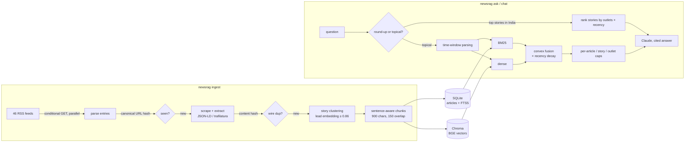

# Dynamic News RAG

Ask questions about today's news and get short answers that cite their sources, drawn from 46 RSS feeds across 16 Indian and international outlets.

```text
$ newsrag ask "What did the RBI decide this week?"
(time filter: this week)

The RBI kept the repo rate unchanged at 5.5% and held a neutral stance; the MPC vote
was unanimous [1][3]. Governor Sanjay Malhotra said inflation is within the target band [1].
Bond yields eased slightly after the announcement [2].

Sources:
  [1] RBI holds repo rate steady, keeps neutral stance
      The Hindu · 6h ago · https://thehindu.com/business/...
  [2] Bond yields ease after policy
      Mint · 5h ago · https://livemint.com/markets/...
  [3] MPC votes 6-0 to keep rates on hold
      BBC News · 7h ago · https://bbc.com/news/...
```

*(The output above shows the format only; it is not a real run.)*

## What it does

- **Pulls in news from many outlets:** 46 feeds from Times of India, The Hindu, Indian Express, Hindustan Times, NDTV, Economic Times, Mint, BBC, The Guardian, Al Jazeera, NPR, DW, Ars Technica, TechCrunch, The Verge and ESPNcricinfo. You can add or remove feeds in [`feeds.toml`](feeds.toml) without touching the code.
- **Gets the full article text:** it reads the schema.org `articleBody` first, then falls back to [trafilatura](https://trafilatura.readthedocs.io/) boilerplate removal, which works on almost any page layout. If a page is paywalled or unreachable, it indexes the RSS summary instead and flags the article as summary-only.
- **Removes duplicates in three ways:**
  1. Links are normalised before hashing: `utm_*` and other tracking parameters, AMP variants, `www.` and fragments are stripped.
  2. Article bodies are hashed, so the same wire copy (PTI/Reuters/AP) republished by several outlets is stored once.
  3. Articles about the same event are grouped into a story by comparing the embeddings of their title and opening paragraph.
- **Uses hybrid search:** SQLite FTS5 BM25 for keyword matching plus BGE vector search in Chroma. The two are combined with min-max normalised convex fusion (reciprocal rank fusion is available as an option). The result is then weighted towards recent articles, capped per article, per story and per outlet (2 each by default) so one source can't fill every slot, and cut off below 40% of the best match's score so weak matches don't pad the answer.
- **Tells round-up questions from topical ones:** "What are the top stories in India today?", "tech headlines" or "catch me up" aren't answered by word matching, which would find "Top stocks to watch today". They rank stories by how many outlets covered them and how recently, read the scope from the question (India, world, business, tech, science, sports), and give the model the opening paragraphs from up to three outlets per story. Routine service pieces (daily fuel prices, "stocks to buy", horoscopes, registration guides) are left out unless the question asks for them.
- **Understands time in questions:** "today", "yesterday", "this week" and "past 3 days" become date filters, and words like "latest" make recency count for more.
- **Cites every claim:** answers carry numbered citations with outlet, date and link. The model is told to use only the retrieved text, to point out when sources disagree, and to ignore any instructions inside article text.
- **Chat with follow-up questions:** a follow-up like "what did the opposition say about it?" is rewritten into a standalone search query using the conversation so far.
- **Daily briefing:** summarises the stories covered by the most outlets in the last N hours.
- **Built-in evaluation:** `newsrag eval` measures recall@k and MRR for BM25-only, dense-only and hybrid retrieval on your own data.
- **Light to re-run and host:** conditional GETs (ETag / Last-Modified) skip feeds that haven't changed, each site is fetched by its own worker (sites in parallel, at most one request per second to any one site), articles are saved in batches as they arrive so an interrupted run keeps its work, video and photo pages are skipped, robots.txt is respected, and articles older than 30 days are deleted automatically. Embeddings run on CPU through ONNX, so PyTorch isn't needed.

## How it works



SQLite is the source of truth. The Chroma index can be rebuilt from it at any time with `newsrag reindex`, for example after switching to a different embedding model.

## Quick start

Requires Python 3.11 or newer.

```bash
git clone https://github.com/SriAkhilMylavarapu/Dynamic_News_RAG.git
cd Dynamic_News_RAG
python -m venv .venv && source .venv/bin/activate
pip install -e .
cp .env.example .env   # then add your ANTHROPIC_API_KEY
```

```bash
newsrag ingest                 # first run takes a few minutes and downloads the ~70 MB embedding model
newsrag ask "What's the latest on the India-US trade deal?"
newsrag chat                   # conversation with follow-ups
newsrag briefing --hours 24    # today's most-covered stories
```

Without an `ANTHROPIC_API_KEY`, everything except written answers still works: `ask` lists the most relevant articles instead.

## Commands

| Command | What it does |
| --- | --- |
| `newsrag ingest [--every 30]` | Poll all feeds once, or every N minutes |
| `newsrag ask "..." [--days 3] [--category tech] [--source "BBC News"] [--json]` | Answer one question with citations |
| `newsrag chat` | Interactive chat; `/new` resets context |
| `newsrag search "..." [--mode bm25\|dense\|hybrid] [--fusion convex\|rrf]` | Show the retrieved passages and their scores, without calling the LLM |
| `newsrag briefing [--hours 24] [--category india]` | Summary of the most widely covered stories |
| `newsrag eval [-n 50] [--headlines]` | Retrieval quality report |
| `newsrag stats` / `newsrag feeds` | Database contents / per-feed poll status |
| `newsrag prune [--days 30]` / `newsrag reindex` | Maintenance |

Add `-v` to any command for logs and timings. `python -m newsrag ...` works too.

### Keeping it fresh

Either leave `newsrag ingest --every 30` running, or add a cron job:

```cron
*/30 * * * * cd /path/to/Dynamic_News_RAG && .venv/bin/newsrag ingest >> data/ingest.log 2>&1
```

## Evaluating retrieval

`newsrag eval` picks a sample of stored articles and has Claude write one specific question from a passage in the **middle** of each article, so the question doesn't just repeat the headline. The questions are cached in `data/eval_questions.json` so later runs can be compared. It then checks whether each retrieval setup returns the source article:

```text
mode              recall@1   recall@3   recall@5  recall@10     mrr@10
bm25                   ...
dense                  ...
hybrid-rrf             ...
hybrid-convex          ...
```

Recency weighting and time parsing are turned off during eval, so it measures relevance only. Use it to tune `NEWSRAG_EMBEDDING_MODEL`, the chunk size or the fusion method on your own data. `--headlines` uses headlines as queries instead; it needs no API key but is a much easier test.

## Configuration

All settings are environment variables; see [`.env.example`](.env.example). The ones you're most likely to change:

| Variable | Default | Notes |
| --- | --- | --- |
| `ANTHROPIC_API_KEY` | none | Needed for written answers, chat and LLM-generated eval questions |
| `NEWSRAG_LLM_MODEL` | `claude-sonnet-5-5` | Any Claude model id, e.g. `claude-opus-5-5` for harder questions |
| `NEWSRAG_LLM_EFFORT` | `low` | `low` / `medium` / `high`: how much the model reasons before answering |
| `NEWSRAG_EMBEDDING_MODEL` | `BAAI/bge-small-en-v1.5` | Any [fastembed model](https://qdrant.github.io/fastembed/examples/Supported_Models/); run `reindex` after changing |
| `NEWSRAG_RETENTION_DAYS` | `30` | Older articles are deleted on each ingest |
| `NEWSRAG_STORY_SIMILARITY` | `0.86` | Lower values group more articles into the same story |
| `NEWSRAG_RECENCY_HALF_LIFE_HOURS` | `72` | Divided by 3 for "latest"-type questions |

## Project layout

```text
newsrag/
  config.py     settings + feeds.toml loader
  fetch.py      HTTP: per-domain rate limit, robots.txt, conditional GET
  extract.py    article body extraction (JSON-LD → trafilatura → RSS summary)
  text.py       URL canonicalisation, hashing, dates, chunking, time-window parsing
  store.py      SQLite: articles, chunks, FTS5 BM25, feed state
  vectors.py    fastembed embeddings + Chroma collections
  ingest.py     the ingestion pipeline
  retrieve.py   hybrid retrieval, fusion, recency, diversification
  assistant.py  answers, chat follow-ups, briefings
  evaluate.py   recall@k / MRR evaluation
  cli.py        `newsrag` command
tests/          offline unit + end-to-end tests (fake feeds, fake LLM)
feeds.toml      news sources
```

Run the tests with `pip install -e ".[dev]" && pytest`. They run fully offline.

## Roadmap

- [ ] FastAPI service (`/ask`, `/chat` streaming, `/briefing`, `/search`). `NewsAssistant` already returns JSON-ready objects for this.
- [ ] Mobile app over that API, with a push notification for the morning briefing
- [ ] Topic watchlists ("tell me when there's news about X")
- [ ] Cross-encoder reranking, compared against the current setup with `newsrag eval`

## Notes

Respect each publisher's terms of use. The scraper identifies itself, follows robots.txt, rate-limits per domain and stores text only for retrieval. It is meant for personal use.

Licensed under the terms in [LICENSE](LICENSE).
